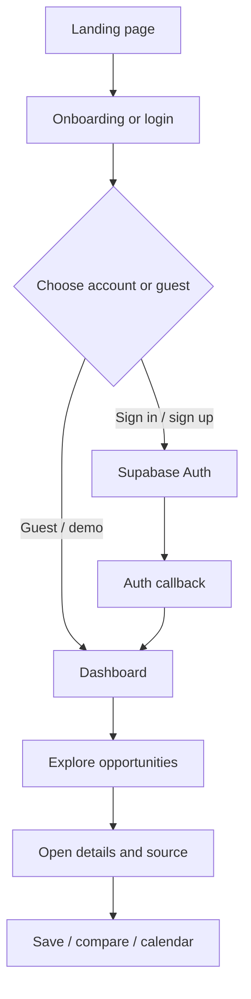
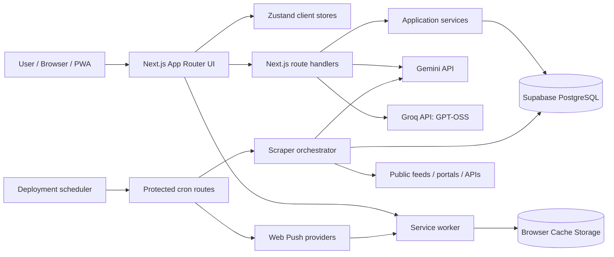
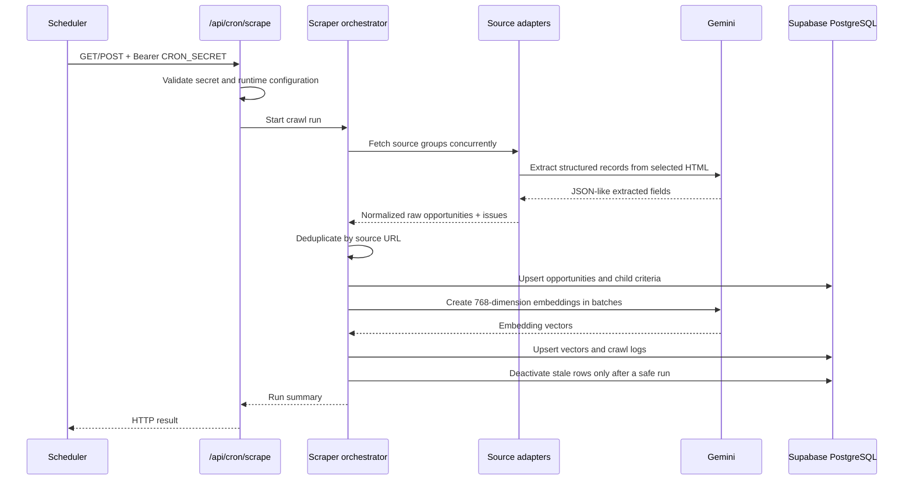

# AvasarSetu

> **A source-linked opportunity discovery Progressive Web App (PWA) for people exploring jobs, internships, scholarships, and selected government schemes in India.**

This README is the technical and viva handbook for the project as it currently exists in this repository. It explains the problem, product boundaries, architecture, data model, application flows, AI/search design, security, local setup, operations, and remaining launch work.

**Read the status labels carefully.** The original project blueprint describes a much broader product than the current MVP. This handbook documents implemented behavior separately from future ideas; a feature appearing in the blueprint does not mean it is already delivered.

---

## Contents

1. [Quick orientation](#1-quick-orientation)
2. [Problem, purpose, and product boundaries](#2-problem-purpose-and-product-boundaries)
3. [Current feature status](#3-current-feature-status)
4. [Users and primary journeys](#4-users-and-primary-journeys)
5. [Architecture at a glance](#5-architecture-at-a-glance)
6. [Technology stack and why it is used](#6-technology-stack-and-why-it-is-used)
7. [Repository map](#7-repository-map)
8. [Frontend and application behavior](#8-frontend-and-application-behavior)
9. [Backend and API behavior](#9-backend-and-api-behavior)
10. [Data model and database theory](#10-data-model-and-database-theory)
11. [Opportunity ingestion pipeline](#11-opportunity-ingestion-pipeline)
12. [Search and recommendation design](#12-search-and-recommendation-design)
13. [Eligibility engine](#13-eligibility-engine)
14. [AI models and their responsibilities](#14-ai-models-and-their-responsibilities)
15. [Authentication, privacy, and security](#15-authentication-privacy-and-security)
16. [PWA, offline behavior, and low-data mode](#16-pwa-offline-behavior-and-low-data-mode)
17. [Notifications and reminders](#17-notifications-and-reminders)
18. [Environment variables](#18-environment-variables)
19. [Local development setup](#19-local-development-setup)
20. [Supabase setup and migrations](#20-supabase-setup-and-migrations)
21. [Run ingestion and verify search](#21-run-ingestion-and-verify-search)
22. [Deployment and scheduled jobs](#22-deployment-and-scheduled-jobs)
23. [Quality checks and current verification](#23-quality-checks-and-current-verification)
24. [Troubleshooting](#24-troubleshooting)
25. [Known limitations and risks](#25-known-limitations-and-risks)
26. [What remains before launch](#26-what-remains-before-launch)
27. [Viva preparation: common questions and answers](#27-viva-preparation-common-questions-and-answers)
28. [Glossary](#28-glossary)
29. [Official technical references](#29-official-technical-references)

---

## 1. Quick orientation

| Item | Current project |
|---|---|
| Name | AvasarSetu |
| Product type | Responsive web application and installable PWA |
| Main purpose | Find and understand source-linked opportunities and compare them against profile details |
| Main audience | Students, job seekers, early-career candidates, and people looking for selected public schemes |
| Geography | Primarily India |
| Frontend/backend framework | Next.js App Router, React, TypeScript |
| Database and auth | Supabase PostgreSQL, Supabase Auth, Row Level Security (RLS) |
| Search | pgvector semantic search, PostgreSQL full-text search, and text fallback |
| AI providers | Google Gemini for extraction and embeddings; Groq-hosted GPT-OSS for optional intent parsing and explanations |
| Main opportunity kinds | Jobs, internships, scholarships, schemes, exams, and selected benefit-like listings |
| Application submission | Not performed by AvasarSetu; users follow the original source link |
| Eligibility decision | Advisory rule comparison only; never an official decision |

### What the app does in one sentence

AvasarSetu gathers opportunity listings from selected public sources, normalizes them into a common catalogue, lets users search and save them, and presents rule-based profile matches with links back to the source.

### What the app does not do

- It does not submit job, scholarship, exam, or scheme applications.
- It does not issue official eligibility decisions or guarantee that a listing is current.
- It does not replace a government department, employer, university, or official portal.
- It does not currently deliver every module described by the full project blueprint.
- The Documents page is a checklist, not a document upload vault.

---

## 2. Problem, purpose, and product boundaries

### 2.1 The problem

Opportunity information is scattered across employer career pages, government notices, scholarship portals, scheme catalogues, and aggregators. A person may need to:

1. Search many unrelated websites.
2. Interpret inconsistent descriptions and eligibility requirements.
3. Track deadlines in separate places.
4. Re-check whether a result is official, recent, or only an aggregator summary.
5. Repeat the process when their education, location, or career interests change.

This project explores a single discovery layer that organizes some of these listings and makes their source and freshness visible.

### 2.2 Product goal

Reduce the effort needed to discover relevant opportunities by combining:

- A normalized opportunity catalogue.
- Search across title, description, authority, and tags.
- Semantic search for conceptually related wording.
- Rule-based profile matching with visible reasons.
- Saved listings and deadline reminders.
- Source links and verification-age indicators.
- Local/offline access to a bounded set of public catalogue data.

### 2.3 Design principles

1. **Source first:** show where a listing came from and link users to its original page.
2. **Explain the match:** show criteria and missing profile information instead of presenting an unexplained score.
3. **Rules before generative decisions:** deterministic rules compare profile fields with normalized criteria; an LLM must not decide eligibility.
4. **Graceful degradation:** local demo data and keyword search keep the application usable when optional services are absent.
5. **Data minimization:** the offline service worker caches public opportunity data, not private profile or account API responses.
6. **Honest scope:** mark unverified data and describe unsupported blueprint features as future work.

### 2.4 The original blueprint versus the delivered MVP

The complete vision in [`AvasarSetu-Project-Blueprint.md`](./CareerCompass-Project-Blueprint.md) includes broader career, education, welfare, civic, and finance guidance. This repository is a narrower MVP focused on opportunity discovery. The blueprint remains useful as product context, but the working software is the authority for what is implemented.

---

## 3. Current feature status

### 3.1 Implemented in the repository

| Area | Implemented behavior |
|---|---|
| Public experience | Landing page, onboarding, login, guest/demo entry, terms, privacy, offline page |
| Opportunity discovery | Dashboard, Explore, filters/search, detail page, source link, freshness display |
| Opportunity types | Jobs, internships, scholarships, schemes, exams, and selected related listing types |
| Search | `/api/search` hybrid search, a legacy `/api/query` intent route, local demo fallback |
| Presentation data | 30 fictional samples: five each for private jobs, government jobs, exams, schemes, policies, and scholarships; marked as demo and never written by the scraper |
| Matching | Deterministic rule checks for age, income, category, education, degree, branch, experience, state, and skills |
| Personal tools | Save/list opportunities, calendar, compare, profile, document checklist, settings |
| Accounts | Supabase email/password flows, callback, password-reset flow, sign-out, and account deletion paths |
| Profile sync | Allowlisted profile fields, user-scoped writes, and an explicit consent step for supported local profile migration |
| Data ingestion | Five source groups, source issue reporting, normalization, deduplication, embeddings, crawl run logs |
| Freshness | Last verification timestamps, relative age, and stale-data warnings in relevant screens |
| Notifications | In-app records, daily deadline job, optional Web Push, subscription removal and endpoint validation |
| PWA | Web manifest, service worker, offline shell/catalogue behavior, bounded public-data caching |
| Low-data mode | Local preference reduces catalogue/search result count and truncates listing descriptions |
| CI definition | GitHub Actions workflow for install, typecheck, lint, and production build |

### 3.2 Partially implemented or dependent on deployment setup

- Live Supabase behavior requires valid project URL/keys and the correct schema/migrations.
- Live embeddings and extraction require a Gemini API key.
- AI query parsing and generative explanations require a Groq API key; deterministic/factual fallback exists without it.
- Web Push requires a matching VAPID key pair and browser permission.
- Scheduled routes require deployment secrets and a scheduler compatible with the configured cadence and function duration.
- Source-health webhook alerts require an HTTPS incoming webhook URL.
- The Playwright renderer can save snapshots for review, but snapshots are not automatically parsed or synchronized into the catalogue.
- Some stored schema tables support future/document checklist behavior, while the current Documents screen is local checklist state and is not a secure file vault.

### 3.3 Not implemented as a complete product feature

- Hindi/localized user experience.
- Linked family/dependent profiles and account-synced dependent preferences.
- Official source-clause citations for each eligibility criterion.
- Broad, reviewed civic-service, finance, health, pension, farmer, disability, college, and business-benefit coverage.
- Automated application submission or agentic form filling.
- A fully reviewed and continuously maintained source-by-source legal/data-quality audit.
- Full automated unit, integration, and browser end-to-end test coverage.
- Production observability and guaranteed source uptime.

### 3.4 Important state of the data

Scraped listings can be incomplete, stale, duplicated, or incorrectly extracted. Aggregator-origin listings are not automatically official. The application should always be presented as a discovery aid: users must verify deadlines, qualifications, and application instructions at the linked source.

---

## 4. Users and primary journeys

### 4.1 User groups

- **Student:** wants internships, entry-level jobs, exams, or scholarships.
- **Job seeker:** wants relevant openings and a place to track saved listings.
- **Early-career candidate:** wants opportunities filtered by education, skills, experience, and location.
- **Opportunity researcher:** wants a searchable catalogue with links and freshness context.
- **Guest/demo user:** wants to explore without creating an account.

These are intended users, not a claim that every user need is fully served.

### 4.2 New visitor and guest flow



Guest mode uses local app state and demo catalogue fallback when live data is unavailable. Client-side navigation is deliberately allowed to continue into the app shell; proxy-level server redirects are bypassed in the current implementation to avoid blocking guest/demo transition. App-side auth checks and account-scoped operations still determine whether a real user session exists.

### 4.3 Search and opportunity detail flow

1. The user types a phrase such as “banking jobs” or “railway recruitment”.
2. Explore sends a request to `POST /api/search`.
3. The server validates the body and rate-limits the request.
4. When configured, it creates a Gemini query embedding and calls the Supabase vector-match function.
5. If semantic results are absent or unavailable, it tries PostgreSQL full-text search and then parameterized text matching.
6. Fictional presentation samples are searched alongside live results and marked visibly; their links use the reserved `example.com` domain.
7. If live search cannot return records, the sample catalogue remains searchable.
8. Explicit profile facts in the query (such as B.Tech graduate, age, category, location, experience, or stated income) are used for that search only; they do not silently update or persist the user's profile.
9. Results are mapped to the common opportunity type, checked against available profile/query facts, scored, and returned with the data source label.
10. The detail screen shows stored facts, eligibility explanation, required documents/steps when present, freshness, and a source link.

### 4.4 Saved listing and reminder flow

1. A user saves an opportunity.
2. Guest data is kept in the local persisted store.
3. A signed-in user also gets best-effort account synchronization through user-scoped APIs/RLS.
4. The daily notification job finds saved opportunities with deadlines in the configured reminder windows (7 days or 1 day).
5. It writes deduplicated in-app notifications and may send push notifications if VAPID is configured.

### 4.5 Profile and privacy flow

1. Onboarding/profile screens collect a subset of fields used by eligibility rules and matching.
2. Guest profile state stays in local storage.
3. A signed-in session may see a consent prompt before supported local profile fields are copied into the account profile.
4. Server APIs validate/allowlist fields and database policies scope user data to the authenticated user.
5. The profile is used to compare with stored opportunity criteria; the rules are not verified facts unless the source has been reviewed.

---

## 5. Architecture at a glance

### 5.1 Logical architecture



### 5.2 Main component responsibilities

| Component | Responsibility |
|---|---|
| Browser UI | Screens, forms, navigation, display of opportunities and matching explanations |
| Zustand stores | Client-side session/demo state, profile/preferences, saved items, notifications, checklist state |
| Next.js route handlers | Request validation, rate limits, server-side secrets, data access, cron execution |
| Domain services | Mapping database rows, search parsing/ranking, eligibility checks, opportunity retrieval |
| Supabase Auth | Identity, session, email/password operations, callback flows |
| PostgreSQL | Durable catalogue and user-scoped records; indexes and RLS policies |
| pgvector | Store and compare 768-dimensional opportunity/query embeddings |
| Gemini | Extract structured opportunity fields from selected HTML and embed text/query strings |
| Groq-hosted GPT-OSS | Optional natural-language intent parsing and bounded plain-language summaries |
| Scraper sources | RSS, public HTML pages, and public endpoints used to refresh the catalogue |
| Service worker | Cache public app/catalogue content, display push notifications, retry queued public searches |
| Scheduler | Invoke protected scrape and reminder jobs on a configured cadence |

### 5.3 Data flow: ingest once, serve many times



### 5.4 Data flow: search

```mermaid
sequenceDiagram
    participant UI as Explore UI
    participant API as /api/search
    participant Gemini
    participant DB as Supabase + pgvector
    participant Search as SearchService
    UI->>API: POST { query, profile?, limit? }
    API->>API: Validate query; apply per-process rate limit
    alt Supabase and Gemini configured
        API->>Gemini: Embed query (768 dimensions)
        Gemini-->>API: Query vector
        API->>DB: RPC match_opportunities(vector, threshold, count)
        DB-->>API: Similar opportunity IDs ordered by similarity
        API->>DB: Hydrate active rows and related criteria
    else No vector matches or vector unavailable
        API->>DB: English full-text query
        DB-->>API: Matching rows
        opt Full-text result unavailable/empty
            API->>DB: ILIKE token fallback
            DB-->>API: Matching rows
        end
    end
    API->>Search: Parse, filter, compute eligibility and ranking
    Search-->>API: Search results
    API-->>UI: Results + total + source label
```

### 5.5 Separation of responsibilities

The UI does not call Gemini directly, so provider secrets remain server-side. The ingestion worker does not ask an LLM to make an eligibility decision. The database stores normalized listing facts and criteria; the matching service applies deterministic comparisons when a profile is available. The service worker handles offline transport/cache behavior but does not own the product database.

---

## 6. Technology stack and why it is used

### 6.1 Stack summary

| Technology | Role | Why it fits this project |
|---|---|---|
| Next.js 16 App Router | Web framework, routing, React rendering, server API routes | One TypeScript codebase can serve application pages and server-only API integrations |
| React 19 | UI component model | Reusable interactive screens and client-side experiences |
| TypeScript | Static type checking | Helps keep profile, opportunity, eligibility, and API shapes consistent |
| Tailwind CSS 4 + project CSS | Styling system | Responsive layout and shared styling; some UI uses inline styles as well |
| Zustand 5 | Client state | Small stores for profile, preferences, auth/demo state, saved items, documents, notifications |
| Supabase | PostgreSQL hosting, Auth, client/server SDK | Managed relational database, user identity, RLS, and SQL functions in one service |
| PostgreSQL | Durable relational storage | Fits structured opportunities, rules, related documents, steps, and user records |
| pgvector | Vector column and similarity operators | Enables semantic retrieval using the same catalogue records |
| Zod 4 | Runtime validation in selected APIs/forms | TypeScript alone disappears at runtime; schemas check untrusted JSON values |
| React Hook Form | Form state and validation integration | Keeps multi-field onboarding/profile forms manageable |
| Google Gemini API | Embeddings and structured extraction | Embeds queries/listings and extracts candidate fields from selected page text |
| Groq API with GPT-OSS 20B | Optional intent parsing and explanation prose | Fast hosted chat completion with JSON response support for intent extraction |
| Web Push + VAPID | Browser push protocol | Enables deadline notification delivery when browser and server configuration allow it |
| Playwright (Python worker) | Optional page rendering | Can render JavaScript-heavy portals into local snapshots for human review |
| Vercel Cron configuration | Scheduled route invocation | Simple deployment-integrated scheduling; schedule depends on plan limits |
| GitHub Actions | CI definition | Checks install, typing, lint, and build after repository publication/configuration |

### 6.2 Why a relational database remains important

The core entities have clear relationships and integrity requirements. An opportunity has one set of eligibility rules and many required documents or application steps. A user has many saved opportunities and notifications. Foreign keys, unique constraints, transactions, and RLS are useful for these relationships. Semantic search supplements relational storage; it does not replace it.

### 6.3 Why use a PWA

A PWA uses ordinary browser technologies while allowing installation, a service worker, offline shell behavior, and web push where supported. It avoids requiring a separate native mobile application for the current MVP. Browser capabilities vary, so offline support and notifications are best-effort and should be checked on target devices.

### 6.4 Why both deterministic code and AI

- Deterministic code is explainable and repeatable for constraints like age ranges or categories.
- Embeddings help retrieve semantically related text even if the user’s exact terms are absent from the listing.
- Generative models can turn a natural query into a structured intent or summarize stored facts in plain language.
- LLM output can be wrong or incomplete, so it must not override the source or determine an official outcome.

---

## 7. Repository map

```text
app/
  (app)/                         Signed-in/application shell screens
    dashboard/                   Recommendations and overview
    explore/                     Search, filters, and catalogue
    opportunities/[id]/          Opportunity details
    saved/ calendar/ compare/    Personal opportunity tools
    profile/ documents/          Profile and local document checklist
    notifications/ settings/     User preferences and notification UI
  api/                           Next.js route handlers
    search/                      Hybrid vector/full-text search
    query/                       Intent-parsing search endpoint
    opportunities/               Catalogue list and detail endpoints
    explain/                     Plain-language opportunity explanation
    profile/ saved/ notifications/
    cron/scrape/                 Protected ingestion endpoint
    cron/notifications/          Deadline reminder endpoint
  auth/                          Auth callback and password reset routes
  login/ onboarding/             Account entry and profile setup
  offline/ privacy/ terms/       Public support pages
components/                      Shared UI, shell, landing, PWA/theme providers
data/demoOpportunities.ts        Demo/fallback opportunity data
lib/                             Supabase clients, rate limit, cron auth, utilities
services/                        Opportunity, search, query, and eligibility domain logic
store/                           Zustand state stores
scripts/live-scraper/            TypeScript ingestion and embedding pipeline
scraper/                         Python Playwright renderer and its instructions
supabase/schema.sql              Base database schema
supabase/migrations/             Incremental database changes
supabase/enable-vector-index.sql Optional vector index setup after initial data load
public/sw.js                     PWA service worker
public/manifest.json             PWA install metadata
types/index.ts                   Shared domain types
TODO-Roadmap.md                  Current status and external launch checklist
CareerCompass-Project-Blueprint.md Original wider product vision
```

### 7.1 Notable services

- `services/OpportunityService.ts`: database/demo retrieval, row mapping, detail lookup, explanation call, and eligibility helper.
- `services/SearchService.ts`: hard filters, text/semantic handling, profile checks, relevance score, and recommendation ordering.
- `services/QueryParser.ts`: deterministic parsing fallback for natural-language query intent.
- `services/EligibilityEngine.ts`: deterministic criterion evaluation and match explanations.
- `store/useProfileStore.ts`, `useSavedStore.ts`, `useNotificationStore.ts`, `usePreferencesStore.ts`, `useDocumentStore.ts`, `useAuthStore.ts`: browser-facing state.
- `scripts/live-scraper/orchestrator.ts`: concurrent source collection, deduplication, sync, stale cleanup guard, and run summary.
- `scripts/live-scraper/supabase-sync.ts`: database write, embedding, and crawl log details.

---

## 8. Frontend and application behavior

### 8.1 Next.js App Router

The `app/` directory defines routes using folders and files. `page.tsx` provides page content; `layout.tsx` wraps child routes with shared UI; `loading.tsx` provides loading states; and `route.ts` implements an HTTP endpoint. Route groups such as `(app)` organize pages without adding the group name to the URL.

The app uses client components for interactive areas such as forms, local stores, and browser features. The root layout includes metadata and the PWA provider. The signed-in application layout restores session/profile state and gates account-specific behavior. Do not assume every page is server-rendered just because Next.js supports server rendering: inspect each component's `use client` boundary and data path.

### 8.2 Screens

| Screen | Purpose |
|---|---|
| `/` | Landing page and product entry point |
| `/onboarding` | Collect initial career/profile preferences |
| `/login` | Guest/demo and account entry options |
| `/dashboard` | Overview and profile-aware recommendations |
| `/explore` | Catalogue search and filters |
| `/opportunities/[id]` | Listing details, match reasons, source, and actions |
| `/saved` | Saved opportunities and statuses |
| `/calendar` | Deadline-oriented view for saved opportunities |
| `/compare` | Side-by-side opportunity comparison |
| `/profile` | Profile editing |
| `/documents` | Local checklist of application documents; no upload vault |
| `/notifications` | Notification list and read state |
| `/settings` | App preferences and account controls |
| `/privacy`, `/terms` | Public policy pages |
| `/offline` | Offline navigation fallback |

### 8.3 State ownership

The application has multiple state lifetimes:

1. **Component state:** temporary UI state such as open panels, input values, and loading flags.
2. **Zustand state:** shared client state across routes, including profile, preferences, auth/demo state, saved entries, checklist state, and notification state.
3. **Browser persistence:** selected stores persist locally for guest and offline usage.
4. **Supabase state:** authenticated profiles, saved records, notifications, and subscriptions can synchronize to the account.
5. **Catalogue state:** shared public opportunity data is read from API/database and can be locally cached by the service worker.

These stores are not interchangeable. Local persistence is not a database backup and should not be treated as secure storage for identity documents or secrets.

### 8.4 Opportunity object and database mapping

The UI uses a camelCase TypeScript object (for example `issuingAuthority`, `salaryOrAmount`, `lastVerifiedAt`). PostgreSQL columns use snake_case (for example `issuing_authority`, `salary_or_amount`, `last_verified_at`). `rowToOpportunity` converts a database record and related rows into the application shape. It also supplies safe defaults for optional text/arrays, maps child documents, and orders application steps.

This adapter keeps database naming and UI naming separate. The mapper currently accepts a loosely typed row, so database/API changes should be checked carefully and ideally strengthened with generated database types in a later hardening pass.

### 8.5 Explore interaction

Explore is connected to `/api/search`, so it can use server-side vector and full-text search. The request includes a query and may include the local profile context for ranking/eligibility. The result carries a source marker (`vector`, `fulltext`, or `demo`) so the interface can distinguish how the search was served. The low-data preference reduces the requested result count and shortens summaries.

### 8.6 Error and loading experiences

The repository includes route loading UI and a root error boundary. API handlers generally return JSON error bodies with status codes for malformed requests, rate limits, unavailable data, and not-found records. In fallback paths, the app may return demo catalogue records; the UI should not label a demo result as a live listing.

---

## 9. Backend and API behavior

### 9.1 API catalogue

| Method and path | Purpose | Important behavior |
|---|---|---|
| `POST /api/search` | Main Explore search | Validates query length (2–200 characters), caps result limit at 50, rate-limits per process, tries vector → full-text → ILIKE → demo |
| `POST /api/query` | Natural-language intent parsing/search | Optional Groq intent JSON, deterministic parser fallback, then SearchService; returns an optional short generated summary |
| `GET /api/opportunities` | List active catalogue records | Bounded pagination and filters; demo fallback when live catalogue is unavailable |
| `GET /api/opportunities/[id]` | Read one opportunity | Resolves live or demo listing by ID |
| `POST /api/explain` | Explain one stored opportunity | Zod input validation, rate limit, model explanation bounded by supplied facts, source appended; factual fallback if model unavailable |
| `GET/POST /api/profile` | Read/update own profile | Authenticated, allowlisted fields, user-scoped database access |
| `GET/POST/DELETE /api/saved` | Read/add/remove or update saved records | User-scoped writes and account synchronization |
| `GET/PATCH /api/notifications` | Read notifications/update read state | User-scoped records |
| `POST/DELETE /api/notifications/push` | Register/remove push endpoint | Authenticated and validates recognized push endpoint patterns |
| `GET /api/health` | Report app/database readiness information | Returns service health status; it is not a complete external uptime monitor |
| `GET/POST /api/cron/scrape` | Trigger ingestion | Requires `Authorization: Bearer <CRON_SECRET>`; may take several minutes |
| `GET/POST /api/cron/notifications` | Generate/send reminders | Protected cron endpoint; uses configured Supabase and optional push keys |

The route implementation is the final reference for exact request/response payload fields. This table describes purpose and key behavior rather than every optional field.

### 9.2 Search endpoint request and response

Example request:

```json
{
  "query": "entry-level fullstack roles in Bengaluru",
  "profile": {
    "educationLevel": "undergraduate",
    "skills": ["TypeScript", "React"],
    "state": "Karnataka"
  },
  "limit": 20
}
```

Example response shape:

```json
{
  "results": [],
  "total": 0,
  "source": "vector"
}
```

`source` is a useful operational hint, but a `vector` source means vector retrieval was used; it does not mean the result is official or accurate. If Supabase/Gemini are not configured or live search fails, the endpoint can return demo results.

### 9.3 Validation and rate limits

- Search checks that the body is JSON and the query is a string of bounded length.
- Search clamps `limit` to the range 1–50.
- Explain uses a Zod schema for a bounded opportunity ID.
- Some profile and account routes use explicit allowlists and authenticated identity.
- Search and explain endpoints apply simple in-memory per-process rate limits.

An in-memory limiter is not a globally coordinated production rate limiter: serverless instances can have separate memory and reset on cold start. Use a shared store or gateway policy if stronger cross-instance limits are needed.

### 9.4 Fallback philosophy

The app favors degraded usefulness over a blank screen:

1. Live Supabase catalogue if available.
2. Vector retrieval when configured and populated.
3. PostgreSQL full-text retrieval.
4. Parameterized text matching when full-text setup/results are unavailable.
5. Local demo catalogue when live retrieval cannot be used.

Fallback is convenient for development and demos. For production observability, the app must make the live/demo distinction visible and monitor repeated fallback use.

---

## 10. Data model and database theory

### 10.1 Entity relationship diagram

```mermaid
erDiagram
    SOURCES ||--o{ OPPORTUNITIES : provides
    OPPORTUNITIES ||--o| ELIGIBILITY_RULES : has
    OPPORTUNITIES ||--o{ REQUIRED_DOCUMENTS : requires
    OPPORTUNITIES ||--o{ APPLICATION_STEPS : describes
    OPPORTUNITIES ||--o| OPPORTUNITY_EMBEDDINGS : represented_by
    AUTH_USERS ||--o| PROFILES : owns
    PROFILES ||--o{ SAVED_OPPORTUNITIES : saves
    OPPORTUNITIES ||--o{ SAVED_OPPORTUNITIES : referenced_by
    PROFILES ||--o{ NOTIFICATIONS : receives
    PROFILES ||--o{ PUSH_SUBSCRIPTIONS : registers
    PROFILES ||--o{ USER_DOCUMENTS : checklist_state
    CRAWL_RUNS ||--o{ CRAWL_SOURCE_RUNS : records

    SOURCES {
      int id PK
      text name
      text url UK
      text type
      text trust_level
      boolean is_active
    }
    OPPORTUNITIES {
      text id PK
      text type
      text title
      text issuing_authority
      text source_url
      timestamptz deadline
      boolean is_active
      tsvector search_vector
    }
    ELIGIBILITY_RULES {
      text opportunity_id PK_FK
      int min_age
      int max_age
      bigint max_income
      text[] required_education
      text[] allowed_categories
      text[] states
      text[] required_skills
    }
    REQUIRED_DOCUMENTS {
      int id PK
      text opportunity_id FK
      text name
      boolean is_required
    }
    APPLICATION_STEPS {
      int id PK
      text opportunity_id FK
      int step_order
      text description
    }
    OPPORTUNITY_EMBEDDINGS {
      text opportunity_id PK_FK
      vector embedding
      text embedded_text
    }
    PROFILES {
      uuid id PK_FK
      text email
      text category
      text education_level
      text state
      text[] skills
    }
    SAVED_OPPORTUNITIES {
      uuid id PK
      uuid user_id FK
      text opportunity_id FK
      text status
    }
    NOTIFICATIONS {
      uuid id PK
      uuid user_id FK
      text dedupe_key UK
      boolean is_read
    }
    PUSH_SUBSCRIPTIONS {
      uuid id PK
      uuid user_id FK
      text endpoint UK
    }
    CRAWL_RUNS {
      uuid id PK
      text status
      timestamptz started_at
      timestamptz finished_at
    }
    CRAWL_SOURCE_RUNS {
      bigint id PK
      uuid run_id FK
      text source_name
      text status
    }
```

`AUTH_USERS` is Supabase's managed `auth.users` table; the application schema references it but does not create or manage it directly.

### 10.2 Main tables

#### `sources`

Catalogues source websites and their type/trust status. `url` is unique. A source record supports administration and source identity, while each opportunity also carries source-name/type/URL snapshots for display.

#### `opportunities`

The central public listing table. It stores a stable text ID, type, title, issuing authority, description, location, deadline, salary/amount, vacancy count, application/source links, tags, source/trust metadata, extraction confidence, active/demo flags, and timestamps.

`source_url` is unique when non-empty in the base schema and has a unique index reinforced by a later migration. A generated `search_vector` combines title, description, and authority for PostgreSQL full-text search.

#### `eligibility_rules`

One row per opportunity, linked by `opportunity_id`. Nullable scalar limits mean “no normalized rule supplied” rather than “unlimited eligibility is officially confirmed.” Arrays represent accepted education levels, degrees, branches, categories, states, and skills.

#### `required_documents` and `application_steps`

Child rows provide a flexible number of documents and ordered instructions per listing. Deleting an opportunity cascades to these child rows.

#### `opportunity_embeddings`

Stores one 768-dimensional vector per opportunity plus the text used to make it and a timestamp. The vector table is separate from the descriptive record so vector-specific access and indexes can be managed independently.

#### `profiles`

Extends Supabase Auth identity with fields used for matching: date of birth, category, education, degree, branch, experience, income, location, skills, interests, and preferences. It references `auth.users(id)` and is created on signup by a database trigger.

#### `saved_opportunities`

Join table between profile and opportunity. The `(user_id, opportunity_id)` pair is unique, preventing duplicate saves for the same user. `status` tracks a simple lifecycle such as saved, applied, in-progress, or expired.

#### `notifications` and `push_subscriptions`

Notifications belong to a user and can have a unique `dedupe_key` to prevent repeated reminders. Push subscription rows hold the browser endpoint and VAPID public-key material needed to send a notification; those rows are user-scoped and must be treated as sensitive operational data.

#### `user_documents`

Schema supports per-user checklist/document metadata. The current product screen is a checklist and does not provide secure document file storage. Do not upload identity documents based on the presence of this table.

#### `crawl_runs` and `crawl_source_runs`

Record run-level and source-level ingestion health: statuses, counts, duration, and bounded issue messages. These records make an ingestion result inspectable instead of reporting only console output.

### 10.3 Keys, constraints, and indexes

- Primary keys uniquely identify rows.
- Foreign keys enforce valid references and define cascade behavior where appropriate.
- Unique constraints prevent duplicate source URLs, user saves, push endpoints, and notification dedupe keys.
- B-tree indexes accelerate common equality/range filters such as type, state, deadline, and active status.
- GIN index on tags supports array membership operations.
- GIN index on `search_vector` supports PostgreSQL full-text search.
- pgvector index is optional and is created after enough rows exist; see the vector section below.

### 10.4 Why normalized related tables

Eligibility conditions, document lists, and steps can vary in count and should be updated independently. Separating them avoids a large collection of unrelated nullable columns or one opaque JSON blob and allows foreign-key integrity. Some flexible values remain arrays or JSON because they are naturally variable collections or run summaries.

### 10.5 Row Level Security (RLS)

RLS is PostgreSQL's row-level authorization layer. It evaluates a policy for each row and operation rather than relying only on frontend checks.

- Public catalogue tables allow public reads; privileged writes are intended for the server/service role.
- Profile, saved, notification, push, and checklist rows use `auth.uid()` ownership conditions.
- Crawl logs are service-role only.
- The service-role secret bypasses RLS and must stay on the server. A browser must never receive it.

Always review the exact policy definitions before applying schema changes, especially if a table gains a new operation or column. Supabase migrations are production data changes and must be applied to the intended project.

### 10.6 Schema and migration files

1. `supabase/schema.sql`: base extension, tables, policies, trigger, indexes, and vector RPC function.
2. `20261115000000_search_vector.sql`: generated search vector and full-text index support for existing installations.
3. `20261115000002_ingestion_push.sql`: operational ingestion and push-related schema changes, including duplicate consolidation and notification deduplication.
4. `supabase/enable-vector-index.sql`: optional IVFFlat vector index script after initial data load.

Migration state is not inferred from merely having a `.sql` file in the repository. The deployed Supabase project must have the required SQL applied.

---

## 11. Opportunity ingestion pipeline

### 11.1 Source groups in code

The TypeScript orchestrator runs five source groups concurrently:

1. **MyScheme:** public scheme listings.
2. **Internshala:** internships/private listings through the shared source adapter.
3. **Government portals:** SarkariResult and FreeJobAlert RSS plus selected HTML portals (IndGovtJobs, IBPS, UPSC, eShram, India.gov.in).
4. **Scholarships:** National Scholarship Portal endpoint and Buddy4Study endpoint.
5. **Private jobs:** currently re-exports the shared Internshala/private-jobs fetch implementation.

The source set and website response formats can change. Inspect `scripts/live-scraper/sources/` before treating a source as currently available or authorized for a new use. The handoff mentioned a `Scrapeability-Audit.md`, but that file is not present in this repository.

### 11.2 Ingestion stages

#### Stage 1: Start a crawl run

The orchestrator records a run start in `crawl_runs`. If database configuration is absent, the manual runner exits with a configuration error rather than pretending that a live sync happened.

#### Stage 2: Fetch sources

Each source adapter fetches an RSS feed, HTML page, or endpoint. Requests use explicit timeouts and browser-like/user-agent headers where implemented. Source errors are reported to the orchestrator instead of silently treating every failure as a valid empty catalogue.

Some RSS/API responses can be parsed with deterministic code. For selected HTML pages, the page text is cleaned and sent to Gemini for bounded structured extraction.

#### Stage 3: Normalize

Adapters map inconsistent source fields to `RawOpportunity`: title, description, opportunity type, authority, deadline, application link, source URL/name/type, location, salary/amount, vacancy count, tags, and eligibility text.

Dates use `parseSourceDate`. If a reliable date is absent or cannot be parsed, the deadline remains `null`; the system should not invent a closing date.

#### Stage 4: Record per-source health

Each group reports a status such as `succeeded`, `empty`, `partial`, or `failed`, a record count, elapsed time, and a bounded issue message. A successful HTTP response with an empty or malformed page can still be difficult to distinguish from a genuinely empty feed; source-quality checks remain important.

#### Stage 5: Deduplicate

The orchestrator drops entries without a source URL and deduplicates records by `sourceUrl` within the run. The database also enforces unique source URL identity. The sync code derives a stable ID from source URL where needed, allowing updates to preserve identity across runs.

#### Stage 6: Upsert records

The sync layer writes the opportunity and related normalized data using the service role. A run summary counts insertions, updates, skips, embeddings, and errors. The exact inserted/updated classification is operational reporting; it should not replace database inspection.

#### Stage 7: Create embeddings

The embedding input combines useful listing text. Gemini `gemini-embedding-001` returns vectors with output dimensionality set to 768. Embeddings are batched to limit request overhead and stored in `opportunity_embeddings`.

The same model and same output dimension must be used for indexed listing text and query text. A vector with a different model or dimension cannot be compared as though it belonged to the same embedding space.

#### Stage 8: Deactivate stale rows safely

Old records are deactivated only if the run has non-empty new data, no source is partial/failed, and sync has no errors. The code applies a seven-day age threshold to sources considered healthy. This guard reduces the chance that a temporary source outage hides the catalogue, but it does not prove that an opportunity is still open.

#### Stage 9: Finish run and alert

The final run status and summary are saved. Optional webhook alerts are sent for repeated unhealthy source outcomes; webhook delivery failures are logged and do not fail the ingestion run.

### 11.3 Source trust and extraction confidence

Trust metadata is not a substitute for human validation. The project implementation only automatically marks selected official-domain hosts (`.gov.in`, `.nic.in`, `.ac.in`) as verified; aggregator listings remain unverified. Domain recognition is a conservative signal, not proof that every page or claim is correct.

An extraction confidence value is also not a calibrated probability unless it has been formally measured against labeled data. Treat it as metadata, not a guarantee.

### 11.4 Playwright renderer

The optional Python worker in `scraper/render_worker.py` can load selected JavaScript-heavy pages and save rendered DOM snapshots for local inspection. It is intentionally read-only: a human can review the snapshot, but it is not automatically fed into the production database. This keeps an experimental renderer from silently creating records.

### 11.5 Responsible source handling

Before using a source at scale, review its terms, robots policy, rate limits, public API conditions, attribution expectations, and privacy implications. Avoid bypassing authentication, paywalls, CAPTCHAs, or technical access controls. A publicly reachable page is not automatically permission for unlimited automated collection.

---

## 12. Search and recommendation design

### 12.1 Search modes

AvasarSetu combines retrieval approaches because each covers different failure cases:

1. **Semantic vector search:** useful for conceptual similarity and synonym-rich queries.
2. **Full-text search:** useful for exact words, stemming, and Boolean-like query syntax.
3. **ILIKE fallback:** simple substring matching when full-text schema or result availability is a problem.
4. **Demo keyword search:** useful without live services and in demo mode.

This is a fallback chain, not a guarantee that all four rankers are blended into one calibrated model. The primary vector path orders candidate IDs by similarity, then hydrates records and applies the app's result logic.

### 12.2 Embeddings in plain language

An embedding is a list of numbers representing the semantic content of text. Texts with related meaning tend to have vectors nearer to one another in the model's vector space. The embedding model turns both an opportunity description and a user's query into 768-number vectors.

For example, “frontend engineer” and a listing mentioning “React UI developer” may be conceptually related even when the exact phrase differs. Semantic similarity is probabilistic retrieval; it does not establish that the listing is eligible, current, or trustworthy.

### 12.3 Cosine distance and similarity

The Supabase function compares vectors using pgvector's cosine distance operator `<=>`. Cosine distance is converted to similarity in SQL:

```text
similarity = 1 - cosine_distance
```

The RPC filters to active opportunities and applies a threshold (the search route currently passes `0.501`), orders by similarity descending, and limits the number of candidates. Thresholds require empirical tuning against representative queries and relevance judgments; `0.501` is a project setting, not a universal definition of a good match.

### 12.4 Full-text search

The generated `search_vector` combines English-normalized title, description, and issuing authority. PostgreSQL's `websearch` parser accepts user-friendly search syntax. A GIN index makes matching documents faster than scanning every row as the dataset grows.

The current generated vector does not automatically include every field such as tags, salary, or source metadata. Those fields can still be included by application-side ranking or filter logic.

### 12.5 ILIKE fallback

The API strips unsafe punctuation from query tokens, caps token count, builds `title`, `description`, and `issuing_authority` substring conditions, and asks Supabase for active rows. This is a pragmatic fallback, not a substitute for a well-maintained full-text index. It may match less precisely and perform worse on a large table.

### 12.6 Application-side ranking

`SearchService` adds relevance signals such as:

- Keyword matches in title/description/authority/tags.
- Title and opportunity type matches.
- Rule-based eligibility and profile field matches.
- Location compatibility.
- Verified-source metadata.
- Near deadlines and expired-listing penalty.

When a profile exists, result sorting first favors fully eligible, then partially eligible, then other results, followed by relevance score. The vector path can preserve vector order after candidate retrieval. This means the final order depends on the code path/options and should be understood when comparing screens.

### 12.7 Recommendations

Dashboard recommendations use profile-aware `SearchService` ranking. Without a profile, the service returns a bounded set of non-expired or undated opportunities. This is a rules-and-ranking approach, not a trained recommender model: there is no user-click training dataset or collaborative filtering in the current code.

### 12.8 Search quality evaluation

To improve search, create a reviewed evaluation set:

1. Collect representative queries in English and target regional languages.
2. Have reviewers label relevant opportunities and explain why.
3. Measure recall at K, precision at K, and ranking quality (for example NDCG).
4. Tune embedding threshold and rank weights against those judgments.
5. Re-run the same evaluation after model, prompt, schema, or source changes.

The `verify-search.ts` script is a smoke check for a few example queries; it is not a formal relevance benchmark.

---

## 13. Eligibility engine

### 13.1 Why a deterministic engine

Age limits, income caps, categories, education, experience, location, and skill criteria are structured comparisons. Deterministic code is easier to inspect, test, explain, and repeat than asking a language model to make a decision from prose. The project therefore uses `services/EligibilityEngine.ts` for these checks.

### 13.2 Criteria currently compared

- Age from date of birth and the current date.
- Maximum annual income.
- Category (General, OBC, SC, ST, EWS where represented).
- Education level.
- Degree substring match.
- Branch/specialization substring match.
- Years of experience.
- State, with `Pan-India` treated as broadly available.
- Required skills using case-insensitive exact string comparison.

The exact accepted values come from `types/index.ts` and the opportunity record. Rules may be absent, incomplete, or extracted incorrectly.

### 13.3 Result logic

The engine counts each rule it can assess as matched, failed, or missing. Missing values are not counted as passes.

- `isEligible` is true only when at least one rule exists and every recorded rule was explicitly matched.
- `isPartiallyEligible` is true when at least one rule matched but one or more other rules failed or need profile information.
- `isUnknown` is true when no rule could be assessed, or when the opportunity has no normalized rules.
- `matchScore` is the integer ratio `matched criteria / recorded criteria × 100`. It is zero when no criteria exist.
- Missing information is shown distinctly from a failed comparison.

The score is a simple indicator of the recorded rule comparison. It is not a probability, legal finding, official qualification, or calibrated ranking score. Missing source rules cannot be inferred by the engine.

### 13.4 Example

Assume a listing requires a graduate degree and age under 30. A profile says “graduate” but has no date of birth:

1. Education matches: one matched criterion.
2. Age cannot be checked: missing information, not proof of disqualification.
3. The result is a partial match: one criterion matched and one is unknown.
4. The score reflects one matched rule of two, and the reason asks the user to add age information and verify the original notice.

If the user enters “I am a B.Tech graduate” in Explore, the parser can use those explicit facts as temporary search context to retrieve degree/education-related listings. Those query facts are not written into the profile. Without any stored profile or explicit query facts, age/category/income/degree rules stay unknown instead of producing a false positive.

If a known age is over the maximum, that is a failed criterion. The app may mark the profile not eligible under the stored rule, but the user must still check the authoritative notification and any exceptions/relaxations.

### 13.5 Important edge cases

- A missing normalized rule often means “unknown/not extracted,” but the engine only checks fields represented as rules. It cannot infer omitted requirements.
- Education hierarchy is used in some search filters, while the eligibility engine's education rule comparison is exact-value membership. These are distinct code paths and can produce different interpretations.
- Skill comparison is exact case-insensitive text equality, so synonyms and equivalent skills may not match.
- Degree and branch matching use substring checks, which can overmatch or undermatch.
- Date-of-birth age depends on the current system date and may differ from a notification's cutoff date.
- Rules may have age relaxations, income definitions, domicile clauses, or document conditions that the current schema cannot fully represent.

### 13.6 Safe user-facing language

Say “matches the criteria we have recorded” or “may be a match.” Do not say “you are officially eligible.” Always show the original source link and encourage review of the latest notice.

---

## 14. AI models and their responsibilities

### 14.1 Current model identifiers

| Model | Current use in this codebase | Why |
|---|---|---|
| `gemini-3.6-flash` | Extract candidate listing fields from selected source page text | Structured, low-latency content extraction with JSON response mode |
| `gemini-embedding-001` | Embed opportunity text and search queries at 768 dimensions | Same embedding space for stored records and queries; 768 dimensions is compatible with the schema |
| `openai/gpt-oss-20b` on Groq | Optional natural-language intent parsing and bounded explanation/summary text | Supports JSON object output for intent extraction and general chat completions |

Model availability and provider identifiers can change. Check the official provider pages linked below before deployment or after a provider deprecation notice. Current code was updated away from retired Gemini 2.0 Flash and Groq Llama 3.1 8B Instant IDs.

### 14.2 Gemini extraction

The scraper removes scripts/styles/tags and sends a bounded text portion of selected pages with a structured extraction prompt. The prompt requests fields such as title, organization, type, deadline, vacancies, salary, eligibility, application link, location, and short description.

Extraction is a candidate data transformation, not source verification. The model may omit content, misunderstand a date, infer the wrong category, or return malformed JSON. Adapters validate only some required fields. Human review and source links remain essential; extraction errors should be monitored.

### 14.3 Gemini embeddings

The embedding model represents both opportunity text and search text. The request specifies `outputDimensionality: 768`, matching PostgreSQL `VECTOR(768)`. The chosen dimensionality is a compatibility and storage decision; changing it requires a coordinated schema/index/data rebuild and re-embedding.

Embeddings are not generative answers and do not store a transparent list of facts. They are numerical retrieval features. Keep the raw listing/source fields in the relational record so the user can inspect the actual evidence.

### 14.4 Groq-hosted GPT-OSS

The Groq API is used optionally in `/api/query` to extract a constrained intent object (type, keywords, state, category, education) and to create a short summary. `/api/explain` supplies stored opportunity facts and asks for a simple explanation with strict instructions not to add facts or decide eligibility. The application appends the source listing URL.

When Groq is unavailable or returns an error, the intent route falls back to deterministic query parsing and the explain route returns a factual template. Generated text should be treated as a convenience layer over stored data, never as a primary source.

### 14.5 Why not use an LLM as the eligibility engine

Language models can produce fluent but unsupported conclusions, may vary between runs, and do not provide a reliable audit trail for legal criteria. A deterministic rule engine gives repeatable comparisons and explicit reasons. The present limitation is that source notices must first be converted into correct structured rules; the LLM does not solve that verification problem.

### 14.6 Prompt and data safety considerations

- Provider API keys are only used in server-side code and environment variables.
- Source text is untrusted input; prompts treat listing facts as data and instruct the model to ignore embedded instructions.
- Input/output lengths are bounded in relevant routes.
- Do not send sensitive profile fields to an LLM unless a product need, consent, provider terms, and privacy review explicitly justify it.
- Add strict response schema validation (for example Zod) to all model-generated structures before trusting or persisting them.
- Retain enough source provenance to audit a generated field back to its source page.

---

## 15. Authentication, privacy, and security

### 15.1 Authentication

Supabase Auth manages credentials and sessions. The repository includes sign-in/sign-up, callback handling, password-reset request and reset page, sign-out, and account-deletion flows. A database trigger creates the profile row after a new auth user is created.

Guest/demo is a separate local experience and should not be confused with an authenticated account. When a user signs in, the app may ask before copying supported local profile data to the account.

### 15.2 Authorization

The server derives authenticated identity from the Supabase session and user-scoped APIs. RLS policies independently constrain user rows using `auth.uid()`. Client-side route presentation is not an authorization boundary; the database policy and server validation are the security boundary.

### 15.3 Secrets

Never commit `.env.local`, API keys, service-role keys, cron secrets, or VAPID private keys. The `.gitignore` excludes local secret files and `.env.example` contains placeholder values only. Do not expose server credentials via `NEXT_PUBLIC_` variables.

### 15.4 Personal data

Profile details can include age-related, income, education, location, and career information. Minimize collection, explain why fields are used, and let the user control account data. Do not upload identity/application documents: current document UI is only a checklist.

### 15.5 Public opportunity data

Public opportunity records can be read without an account. RLS policies reserve writes for trusted server/service-role paths. Public does not mean verified: a source link and trust label should remain visible.

### 15.6 Web Push endpoints

Push endpoints can be abused as server-side request targets if arbitrary URLs are accepted. Registration validates recognized push service endpoint patterns and requires an authenticated user. Keep this validation in place and avoid creating a general-purpose URL fetch endpoint.

### 15.7 Rate limits and abuse

The current in-memory rate limit is simple and useful for a single process, but is not sufficient as a globally consistent quota across serverless instances. Production hardening can add shared storage, edge/gateway controls, bot controls, and provider-specific budgets.

### 15.8 Legal and user trust boundary

Do not present this system as legal, financial, or official government advice. The source is the authoritative place to confirm status, deadlines, criteria, and application procedure. Data extraction and matching are assistive.

---

## 16. PWA, offline behavior, and low-data mode

### 16.1 Installation

`public/manifest.json` declares app metadata and install behavior. The root layout includes PWA metadata/provider code. Installation prompts and icons depend on browser support and valid deployed HTTPS.

### 16.2 Service worker lifecycle

`public/sw.js` uses a versioned cache. On install it precaches a small shell set, then on activation deletes older AvasarSetu caches and claims clients. Increment the cache version when changing incompatible cached response formats or major service-worker behavior.

### 16.3 Cache strategies

- **Shell/static pages:** cache-first behavior with network fallback; navigation can fall back to `/offline`.
- **Public opportunity list/detail GETs:** network-first; successful responses are cached, with a maximum of 50 cached requests. If the network fails, a matching cached response may be returned.
- **Search POST:** network-first. On network failure, only query text and a bounded limit are queued; profile data is deliberately excluded.
- **Account-specific APIs:** not cached by the service worker.

### 16.4 Offline search queue limitation

When offline, search returns an empty result object and queues the public query for retry on reconnection/background sync. The worker retries the query and informs open pages that sync completed, but the queue does not currently act as a durable user-visible offline search-results history. Cached catalogue records may still be browsed separately.

### 16.5 Low-data mode

The low-data preference is local. It reduces requested catalogue/search counts and truncates list descriptions. It does not guarantee a specific bandwidth savings and does not currently compress all assets or provide a network-wide quota.

### 16.6 Browser compatibility

Service workers, Background Sync, push APIs, and installability differ across browsers and operating systems. The app should work online without these capabilities; unsupported browser features should degrade gracefully. Verify target browsers/devices before a launch claim.

---

## 17. Notifications and reminders

### 17.1 In-app reminders

The daily notification route inspects saved opportunities and creates deadline reminders for the configured 7-day and 1-day windows. A dedupe key prevents the same reminder from being created repeatedly. Expired or undated opportunities do not produce those date-based reminders.

### 17.2 Web Push

If VAPID keys are configured and a user grants browser permission:

1. The browser creates a PushSubscription using the public VAPID key.
2. The client posts the subscription to the authenticated push API.
3. The server stores it for that user.
4. A reminder job sends a Web Push payload.
5. The service worker displays a notification; clicking it opens/focuses the relevant app URL.
6. Invalid/expired endpoints are removed when the send response indicates they can no longer be used.

Push is optional. In-app reminders are still a separate feature. Browser permission can be denied or revoked, and providers may delay delivery.

### 17.3 VAPID key pair

VAPID identifies the application server to push services. The public key is safe for browser subscription setup and uses `NEXT_PUBLIC_`; the private key remains server-only. Both must belong to the same generated pair.

---

## 18. Environment variables

Copy `.env.example` to `.env.local` for local development. Use real values only in the local untracked file or a deployment secret manager.

| Variable | Required for | Public? | Description |
|---|---|---:|---|
| `NEXT_PUBLIC_SUPABASE_URL` | Live database/auth | Yes | Supabase project URL |
| `NEXT_PUBLIC_SUPABASE_ANON_KEY` | Browser-safe Supabase operations | Yes | Supabase anon/publishable key; RLS must protect data |
| `SUPABASE_SERVICE_ROLE_KEY` | Ingestion and privileged server database work | **No** | Server-only elevated key; bypasses RLS |
| `GEMINI_API_KEY` | Embeddings and selected HTML extraction | **No** | Google AI Studio API key |
| `GROQ_API_KEY` | Optional intent/explanation generation | **No** | Groq API key |
| `CRON_SECRET` | Scheduled endpoint protection | **No** | Long random secret expected in Bearer authorization header |
| `CRAWL_ALERT_WEBHOOK_URL` | Optional repeated crawl alerts | **No** | HTTPS incoming webhook URL |
| `NEXT_PUBLIC_VAPID_PUBLIC_KEY` | Browser push registration | Yes | Public VAPID key from the pair |
| `VAPID_PRIVATE_KEY` | Server-side push send | **No** | Private half of VAPID pair |
| `VAPID_EMAIL` | Web Push sender identity | No | Contact URI, commonly `mailto:...` |
| `NEXT_PUBLIC_APP_URL` | Auth callbacks and generated URLs | Yes | Canonical app origin, e.g. local `http://localhost:3000` |

The `.env.example` is the canonical variable list. A feature without its optional key should use a fallback or be unavailable; verify each endpoint's exact runtime checks before diagnosing a deployment.

---

## 19. Local development setup

### 19.1 Prerequisites

- Node.js 22 or later.
- npm.
- A supported operating system with the Node toolchain.
- Optional: a Supabase project and provider API keys for live data.

The Python Playwright renderer has separate dependencies in `scraper/README.md` and is not required to run the web application.

### 19.2 Install and start

PowerShell:

```powershell
npm ci
Copy-Item .env.example .env.local
npm run dev
```

Open `http://localhost:3000`.

If no real provider credentials are set, the application can show demo opportunities. That confirms the local UI can run; it does not confirm the live Supabase, embedding, auth, or notification integrations.

### 19.3 Useful commands

```bash
npm run dev        # local development server
npm run typecheck  # TypeScript static check
npm run lint       # ESLint
npm run build      # optimized production build
npm start          # serve the production build locally
```

### 19.4 Development loop

1. Start the dev server.
2. Reproduce a behavior in the relevant screen.
3. Inspect the browser console and server terminal separately.
4. Check the matching API route/service/store rather than adding business logic only to the component.
5. Run typecheck and lint after changes.
6. For UI changes, inspect relevant viewport sizes and offline states in a browser.
7. For schema changes, update the base schema/migration and test against a non-production Supabase project.

### 19.5 Do not accidentally use live data

Before running ingestion, verify `NEXT_PUBLIC_SUPABASE_URL` points to the intended Supabase project and `SUPABASE_SERVICE_ROLE_KEY` belongs to that project. Ingestion performs persistent writes and may deactivate stale catalogue rows after a healthy run.

---

## 20. Supabase setup and migrations

### 20.1 Create/configure the project

1. Create a Supabase project.
2. In project settings, copy the project URL and anon/publishable key.
3. Keep the service-role key server-side only.
4. Set the authentication site URL and redirect/callback URLs for local and production environments.
5. Enable email/password authentication if that is the desired account flow.

### 20.2 Apply schema

For a new project:

1. Open Supabase Dashboard → SQL Editor.
2. Review `supabase/schema.sql` before running it.
3. Execute it against the intended project.
4. Apply subsequent migrations in timestamp order.
5. Inspect tables, indexes, function, trigger, and RLS policies in the dashboard.

For an existing database, do not blindly rerun the base schema as a substitute for migration review. Check which migrations are already applied and inspect any duplicate/data-cleanup statements before running the next migration.

Current migration files:

```text
supabase/migrations/20261115000000_search_vector.sql
supabase/migrations/20261115000002_ingestion_push.sql
```

### 20.3 Check auth profile trigger

The base schema defines `handle_new_user()` and an `auth.users` trigger that inserts a corresponding profile row. After creating a test account, verify the row exists and that profile policies allow the account to access only its own data.

### 20.4 Check policies

Test with both an anonymous session and two different authenticated users:

- Public catalogue reads should work as intended.
- User A must not read or modify User B's profile/saves/notifications/subscriptions.
- Anonymous clients must not write catalogue rows.
- Service-role operations must be confined to trusted server code.

### 20.5 Enable vector index when appropriate

The optional `supabase/enable-vector-index.sql` creates an IVFFlat cosine index and analyzes the table. It is intended after the embedding table has at least around 100 rows, as stated by the project setup notes. Confirm the actual row count and inspect the SQL before running.

The `lists` parameter controls the index's coarse partitions. IVFFlat is an approximate nearest-neighbor index; query probes and dataset size affect recall/latency. A sequential scan can be acceptable for a small catalogue. Indexing strategy should be measured on representative queries rather than selected only by rule of thumb.

---

## 21. Run ingestion and verify search

### 21.1 Configure a local environment

Set valid `NEXT_PUBLIC_SUPABASE_URL`, `SUPABASE_SERVICE_ROLE_KEY`, and `GEMINI_API_KEY` in `.env.local`. Confirm the database schema and migrations have been applied first.

### 21.2 Run the live scraper

```bash
npx tsx scripts/live-scraper/run.ts
```

The runner loads `.env.local`, checks required variables, prints the Supabase hostname, executes all source groups, and reports source counts, records fetched/deduplicated, inserted/updated records, embedding count, errors, deactivations, and elapsed time.

Do not treat a successful process exit as proof every source returned valid data. Inspect each source status and the persisted `crawl_runs`/`crawl_source_runs` entries.

### 21.3 Verify hybrid search

```bash
npx tsx scripts/live-scraper/verify-search.ts
```

The smoke script checks representative terms such as `fullstack`, `banking`, and `railway`. Then open Explore in the app and confirm:

1. Search returns relevant live listings.
2. Result source indicates `vector` when vector retrieval succeeded.
3. A query still works without vectors using full-text or ILIKE fallback.
4. The detail page opens and points to the source URL.
5. A missing/expired deadline is displayed honestly.
6. Profile-based match reasons do not claim official eligibility.

Earlier manual ingestion/search smoke results are recorded in [`TODO-Roadmap.md`](./TODO-Roadmap.md). They are historical evidence, not a guarantee that the current external sources or credentials still work.

### 21.4 Inspect data quality

After ingestion, sample records from each source group and compare title, authority, deadline, apply URL, eligibility, and location with the source page. Review duplicates, hallucinated or malformed fields, extraction confidence, and trust status before broad use.

---

## 22. Deployment and scheduled jobs

### 22.1 Build and deploy

The intended deployment model is a Next.js-compatible host such as Vercel, with a managed Supabase project and configured provider secrets. Before deployment:

1. Apply/review Supabase migrations.
2. Configure environment variables for the production Supabase project.
3. Set the production callback/site URL and allowed redirects in Supabase Auth.
4. Confirm application origin, cron secret, provider keys, and VAPID pair.
5. Run typecheck, lint, and production build.
6. Deploy a preview first and exercise guest, account, search, save, and notification flows.
7. Inspect server logs and database crawl records after a controlled first sync.

### 22.2 Cron schedules

`vercel.json` currently declares:

| Route | Schedule | Purpose |
|---|---|---|
| `/api/cron/scrape` | `0 */6 * * *` | Refresh opportunities every six hours |
| `/api/cron/notifications` | `30 3 * * *` | Daily deadline reminders |

Both routes require `Authorization: Bearer <CRON_SECRET>`.

**Deployment-plan constraint:** Vercel Hobby cron jobs are limited to once per day. The six-hour expression therefore requires a plan that supports the cadence, a changed schedule, or an external scheduler. The scrape route allows up to 300 seconds and a prior manual run was reported around 220 seconds; verify the selected hosting plan/runtime limit and current compute settings before relying on this duration. Cron failures must be monitored; do not assume failed jobs will automatically retry.

### 22.3 Protect cron endpoints

- Use a high-entropy `CRON_SECRET` in the deployment secret manager.
- Never put it in a public frontend variable or client code.
- Confirm unauthenticated requests receive an authorization failure.
- Rotate the secret if exposed.
- Log run outcomes without printing secrets or private profile contents.

### 22.4 CI

`.github/workflows/ci.yml` defines dependency installation, typecheck, lint, and build checks for pushes and pull requests. This workspace may not include Git repository metadata; the workflow runs only after the project is initialized/pushed to a GitHub repository with Actions enabled.

---

## 23. Quality checks and current verification

### 23.1 Checks recorded for this repository state

The project roadmap records the following checks as completed after the prior implementation pass:

- `tsc --noEmit` passed.
- ESLint passed with no errors or warnings.
- `node --check public/sw.js` passed.
- Production `next build` passed after elevated filesystem access; sandboxed Windows builds intermittently encountered `EPERM` creating generated route output directories.
- A historical manual ingestion inserted/updated records and generated embeddings, and the representative fullstack/banking/railway search smoke check returned vector matches.

These checks are recorded in [`TODO-Roadmap.md`](./TODO-Roadmap.md). They are not rerun by reading this README, and the historical live-data smoke run does not guarantee current external source availability.

### 23.2 What has not been proven

- No complete automated unit, integration, or end-to-end test suite is currently documented as passing.
- The Playwright renderer was not run in the prior implementation environment because Python was unavailable there.
- No full cross-browser/accessibility/mobile acceptance audit is claimed.
- CI configuration exists, but a GitHub run must be observed after repository publication.
- External Supabase migrations, Vercel settings, VAPID setup, cron execution, and real account flows must be checked in the actual deployment.

### 23.3 Verification command set

```bash
npm run typecheck
npm run lint
npm run build
node --check public/sw.js
```

Do not describe a feature as production verified just because it compiles. Compile-time checks do not test provider credentials, RLS policies, page usability, data accuracy, or scheduled execution.

---

## 24. Troubleshooting

| Symptom | Likely cause | What to check |
|---|---|---|
| App shows demo records | Supabase variables absent/placeholder, schema missing, or live request failed | Browser network request, server logs, URL/key validity, `/api/health`, schema and RLS |
| Search says `demo` | Live search path unavailable or failed | Gemini key, embedding API response, Supabase RPC function, full-text migration, server logs |
| Search returns no semantic matches | No embeddings, dimension mismatch, threshold too high, or query/data mismatch | Count `opportunity_embeddings`, verify vector dimensions/model, RPC threshold and active records |
| Search works only by literal phrase | Embedding or full-text fallback not configured | Gemini API, `match_opportunities`, generated `search_vector`, GIN index |
| `match_opportunities` RPC error | Function missing or parameter/schema mismatch | Apply/review base schema and migrations; inspect function signature |
| `null value in column id` while syncing | Older sync code/schema assumptions or ID generation regression | Ensure stable ID generation in `supabase-sync.ts`; inspect conflicts and schema types |
| Scraper returns zero rows | Source outage, changed HTML/API, request blocked, or extraction failure | Per-source crawl log, source URLs, HTTP status, timeout, model response and source layout |
| Some sources show partial/failed | One or more fetch/extraction operations failed | Crawl source logs; stale deactivation should be skipped on partial/failed runs |
| Old listings stay visible | Source did not report healthy data, sync errors, or not enough new data | Run status, `is_active`, `last_verified_at`, source health and deactivation guard |
| Six-hour Cron rejected by host | Plan cannot schedule every six hours | Upgrade/choose scheduler, reduce frequency, or use external scheduler |
| Cron returns unauthorized | Missing/wrong Bearer secret | `CRON_SECRET` in deployment and exact Authorization header format |
| Scrape Cron times out | Function runtime limit shorter than run time | Runtime/compute plan; reduce source work or move ingestion to a dedicated worker |
| Push does not arrive | No permission, wrong VAPID pair, missing server keys, invalid subscription | Browser permission, key pair, endpoint row, server logs, push provider response |
| User data not syncing | No authenticated session, consent not granted, policy/schema mismatch | Supabase Auth session, profile API response, RLS policy, migration state |
| Account deletion fails | Auth/session, row dependency, or server-side deletion error | Server logs, foreign-key cascade, user identity and cleanup behavior |
| Offline page appears despite cache | Page was never cached or cache version was replaced | Visit online first, service-worker registration, Application → Cache Storage |
| Offline search is empty | Search is queued, not evaluated locally | Reconnect and retry; cached public listings may still be browsed |
| Local production build fails with `EPERM` on Windows | Restricted filesystem/process behavior during generated output | Retry in an approved environment or inspect the precise Next output-path error |
| Gemini/Groq model not found | Provider retired or model identifier changed | Official model catalog/deprecation docs; update server code and verify API access |

---

## 25. Known limitations and risks

1. **Source drift:** external feeds and websites can change without notice.
2. **Data extraction errors:** AI/parsers may miss or misread deadlines, eligibility, salary, or links.
3. **Freshness is not truth:** a recent scrape does not prove the source listing is still open or valid.
4. **Deadline ambiguity:** formats, time zones, and extension notices may be interpreted incorrectly.
5. **Trust classification is shallow:** domain-based verification cannot confirm every listing's authenticity.
6. **Limited structured rules:** complex exceptions and clauses are not fully represented.
7. **Matching false positives/negatives:** string matching and incomplete rules can misclassify a profile.
8. **Search tuning:** semantic thresholds and rank weights have not been validated on a formal relevance benchmark.
9. **Rate limiting:** in-memory limits do not coordinate across serverless instances.
10. **Offline behavior:** cached records can be stale; queued query retries do not create durable result history.
11. **Reminder delivery:** browser push depends on permission and provider availability.
12. **Cron duration:** source fetching plus AI extraction/embeddings can take several minutes.
13. **No broad observability:** health route and crawl logs do not replace error tracking, alerting, or uptime monitoring.
14. **No full automated test suite:** a passing build does not prove every user journey works.
15. **Sensitive document boundary:** the checklist is not a secure document vault.
16. **Language coverage:** the current documented extraction/search setup is mainly English and does not promise Hindi support.

---

## 26. What remains before launch

The operational and product launch checklist is maintained in [`TODO-Roadmap.md`](./TODO-Roadmap.md). The key external steps are summarized here.

### 26.1 External account/deployment work

1. Apply the required Supabase base schema/migrations to the intended project.
2. Configure local and deployed Supabase/Gemini/Groq secrets as needed.
3. Run a controlled live ingestion and inspect records, embeddings, and crawl logs.
4. Verify live Explore queries such as `fullstack`, `banking`, and `railway`.
5. Review and create the IVFFlat index after confirming enough embeddings.
6. Configure production cron secrets and the VAPID key pair if push is desired.
7. Choose a scheduler/hosting plan compatible with six-hour cadence and scrape duration.
8. Verify health, sign-in, search, saved sync, reminders, push enable/disable, and account deletion on the deployed project.
9. Publish/configure GitHub Actions and observe a successful CI run.

### 26.2 Human data review

1. Review source terms, access rules, and attribution.
2. Sample each source's extracted records against the original page.
3. Correct source trust status and remove invalid/duplicated records.
4. Review freshness language, deadline display, and source links.
5. Confirm eligibility rules from authoritative notices before presenting them as useful matching data.

### 26.3 Engineering/product work

- Add automated unit tests for parsers, normalization, eligibility rules, ranking, and validation.
- Add API/database integration tests using a non-production Supabase project.
- Add browser e2e coverage for guest, signup, search, save, offline, push, and account deletion flows.
- Perform accessibility, responsive, localization, and privacy reviews.
- Add centralized error monitoring, logs/alerts, and uptime checks.
- Add robust source-level quality checks and model-output schema validation.
- Add dependent profiles, Hindi, source-clause citations, and broader datasets only with reviewed requirements/data.

### 26.4 Step-by-step user action guide

This is the action sequence the project owner should follow after the code work is complete. Complete one stage, verify it, then continue.

#### Step 1 — Prepare the Supabase project

1. Sign in to Supabase and open the AvasarSetu project (or create one).
2. Open **Project Settings → API** and copy the project URL and anon/publishable key.
3. Keep the service-role key private; do not paste it into frontend code, screenshots, or public chats.
4. Open **SQL Editor** and inspect `supabase/schema.sql`.
5. For a new project, run the base schema once.
6. Apply `20261115000000_search_vector.sql`, then `20261115000002_ingestion_push.sql`, unless the dashboard confirms they are already applied.
7. In **Table Editor**, confirm expected tables exist: `opportunities`, `opportunity_embeddings`, `profiles`, `saved_opportunities`, `notifications`, `crawl_runs`, and `crawl_source_runs`.
8. In **Database → Policies**, confirm RLS is enabled and policies match the ownership rules documented above.
9. In **Authentication → URL Configuration**, set the local and production site/redirect URLs that the app uses.

#### Step 2 — Set up local secrets

1. In the project folder, copy `.env.example` to `.env.local` if it does not exist.
2. Set `NEXT_PUBLIC_SUPABASE_URL` to the Supabase project URL.
3. Set `NEXT_PUBLIC_SUPABASE_ANON_KEY` to the browser-safe anon/publishable key.
4. Set `SUPABASE_SERVICE_ROLE_KEY` to the server-only service-role key.
5. Create a Gemini API key and set `GEMINI_API_KEY`.
6. If you want natural-language intent parsing and generated explanations, create a Groq API key and set `GROQ_API_KEY`.
7. Set `NEXT_PUBLIC_APP_URL=http://localhost:3000` for local testing.
8. Leave push keys blank unless testing Web Push; never expose `VAPID_PRIVATE_KEY`.
9. Save `.env.local`; verify it remains ignored by Git.

#### Step 3 — Run and inspect the project locally

1. Run `npm ci` in the repository folder.
2. Run `npm run dev`.
3. Open `http://localhost:3000`.
4. Test the app as a guest first; verify dashboard → Explore → opportunity detail.
5. Search `fullstack`, `banking`, and `railway` and note whether the response says `vector`, `fulltext`, or `demo`.
6. If using Supabase Auth, create a test account and verify the profile is created.
7. Test sign-out, password-reset flow, and account deletion with a disposable account before any real user data is added.

#### Step 4 — Run the scraper carefully

1. Re-check that the `.env.local` Supabase URL points to the intended non-production project while learning the pipeline.
2. Verify migrations are applied.
3. Run `npx tsx scripts/live-scraper/run.ts`.
4. Read the complete terminal summary; inspect failed/partial/empty source groups.
5. In Supabase, inspect `crawl_runs` and `crawl_source_runs` for the run.
6. Sample opportunity rows and compare them to the source pages.
7. Check that embeddings exist and have dimension 768.
8. Repeat only after fixing source or schema errors; do not repeatedly run against production without checking side effects.

#### Step 5 — Verify search quality

1. Run `npx tsx scripts/live-scraper/verify-search.ts`.
2. Open Explore and repeat the representative queries.
3. Confirm vector search is used when Gemini, vectors, and the RPC are available.
4. Temporarily test fallback behavior with vector configuration unavailable in a safe local environment.
5. Open several results and verify source URL, deadline, authority, and freshness.
6. Test a sample profile and make sure explanations say “match”/“may match,” not official eligibility.

#### Step 6 — Enable vector indexing

1. In Supabase, count rows in `opportunity_embeddings`.
2. Ensure there are at least about 100 populated vectors and that every vector has the same 768 dimensions.
3. Read `supabase/enable-vector-index.sql` and confirm its index/operator settings.
4. Run it in SQL Editor.
5. Re-run representative searches and observe query behavior/performance.

#### Step 7 — Set up production hosting

1. Push the repository to GitHub (if it is not there yet) and confirm the CI workflow runs.
2. Import the repository into the selected Next.js host.
3. Add production Supabase URL and anon key to the host's environment settings.
4. Add the service-role, Gemini, Groq, cron, and VAPID secrets only as server-side secrets.
5. Set `NEXT_PUBLIC_APP_URL` to the exact HTTPS production origin.
6. Add the production origin and callback URLs to Supabase Auth configuration.
7. Choose a plan/scheduler that supports the desired cron frequency and execution duration.
8. Deploy a preview and exercise the complete guest/auth/search/save flows before production.

#### Step 8 — Configure cron and push

1. Generate a long random `CRON_SECRET` and set the same value in deployment secrets.
2. Verify cron requests use `Authorization: Bearer <CRON_SECRET>`.
3. If Vercel Hobby is used, change the schedule to a supported cadence or select another scheduler/plan; six-hour cron is not supported there.
4. Generate a VAPID key pair with `npx web-push generate-vapid-keys` if push is needed.
5. Put the public key in `NEXT_PUBLIC_VAPID_PUBLIC_KEY` and the private key in `VAPID_PRIVATE_KEY`.
6. Set `VAPID_EMAIL` to an app contact URI.
7. Test browser permission, subscription registration, a reminder delivery, and unsubscribe/removal.

#### Step 9 — Final launch review

1. Confirm `/api/health` reports the expected services.
2. Confirm a live search is not silently returning demo data.
3. Confirm a user cannot access another user's profile, saves, or notifications.
4. Confirm an unauthenticated user cannot call protected account mutations.
5. Confirm source links point to the intended official/original pages.
6. Confirm deadlines and eligibility from the authoritative notice.
7. Confirm offline cache does not contain profile/account responses.
8. Confirm a crawl failure alerts the maintainer and does not hide all active records.
9. Record a successful deployment and the exact migration/model/scheduler configuration.
10. Only then invite users, with clear disclosure that the app is an informational discovery aid.

---

## 27. Viva preparation: common questions and answers

### Product and requirements

**Q: What is AvasarSetu?**  
A: It is a source-linked opportunity discovery PWA. It organizes selected jobs, internships, scholarships, and schemes and helps users search, save, compare, and inspect profile matches.

**Q: What problem does it solve?**  
A: Opportunity information is distributed across many portals and formats. AvasarSetu provides one searchable catalogue with source links, freshness context, matching reasons, and deadline tracking.

**Q: Is this the entire vision in the blueprint?**  
A: No. The current MVP focuses on opportunity discovery and limited scholarship/scheme ingestion. Wider civic, finance, education-benefit, localization, and dependent-profile ideas remain roadmap work.

**Q: Does the app apply on behalf of the user?**  
A: No. It links to the source. The user reviews the official instructions and applies there.

### Architecture

**Q: Explain the architecture in 30 seconds.**  
A: The browser runs a Next.js/React PWA. Next.js route handlers validate requests and call domain services. Supabase PostgreSQL stores opportunities and user records, with RLS protecting user rows. A scraper refreshes selected public sources and creates Gemini embeddings. Search uses pgvector first, then full-text/text fallbacks. A service worker caches public catalogue data and supports optional push.

**Q: Why Next.js?**  
A: It combines route-based React UI with server-side API handlers in one TypeScript project, so provider secrets and database operations can remain on the server while the UI remains interactive.

**Q: What does the service layer do?**  
A: It keeps domain behavior such as row mapping, eligibility checks, parsing, and ranking out of the page components, which makes the behavior more reusable and easier to inspect.

**Q: What is the difference between frontend state and database state?**  
A: Zustand/local persistence supports interactive and guest/offline behavior in the browser. Supabase stores durable account/catalogue data. Local state is not a substitute for server persistence or access control.

### Database and security

**Q: Why PostgreSQL/Supabase?**  
A: The data has relational structure and integrity rules, while PostgreSQL also provides full-text search and, through pgvector, vector similarity. Supabase adds hosted Postgres, authentication, SDKs, and RLS.

**Q: What is RLS?**  
A: Row Level Security applies database policies to individual rows. For user-owned tables, policies check that `auth.uid()` matches the row's `user_id` or profile ID.

**Q: Why can’t frontend checks alone secure the data?**  
A: Browser code can be modified or API requests can be sent directly. The server and database must enforce identity and row ownership independently of UI visibility.

**Q: Why must the service-role key stay secret?**  
A: It is privileged and can bypass normal RLS protections. Exposing it could allow unauthorized access or modification of data.

### Search and AI

**Q: What is an embedding?**  
A: It is a numerical vector representing text meaning. Similar query and listing meanings can be close in vector space even when they use different words.

**Q: Why combine vector and full-text search?**  
A: Vector search helps semantic similarity; full-text search helps exact terms and has predictable database behavior. A text fallback preserves basic search when vector infrastructure is unavailable.

**Q: What does cosine similarity mean here?**  
A: The database uses cosine distance between query and opportunity vectors and converts it to `1 - distance`. Higher similarity is used to rank candidates. It is a retrieval signal, not a correctness score.

**Q: Why 768 dimensions?**  
A: The embedding calls request 768 output values, and the database column is `VECTOR(768)`. Both documents and queries must use the same model and dimension to compare correctly.

**Q: What does Gemini do?**  
A: It creates text embeddings for semantic search and extracts candidate structured fields from selected page text. It does not make official eligibility decisions.

**Q: What does GPT-OSS on Groq do?**  
A: Optionally turns a natural-language query into a constrained intent object and writes short explanations from facts already stored in the opportunity record. A deterministic/factual fallback is used if the provider is unavailable.

**Q: Why not let an LLM decide eligibility?**  
A: Eligibility needs repeatable comparison against explicit criteria. A generative model can invent or vary conclusions. The code uses deterministic rules and shows the criteria it could compare.

**Q: Is the match score a probability?**  
A: No. It is a simple indicator based on passed, failed, and missing criteria. It is not statistically calibrated or an official decision.

### Ingestion and data quality

**Q: How does ingestion work?**  
A: Source adapters fetch public RSS/HTML/API data, normalize it, optionally ask Gemini to extract fields from HTML, deduplicate by source URL, upsert rows, create embeddings, log source outcomes, and deactivate stale rows only after a sufficiently healthy run.

**Q: Why store crawl logs?**  
A: They show whether a run succeeded, which sources returned records, how long they took, and what failed. Without them, zero results could mean either “no listings” or a broken scraper.

**Q: How do you avoid deleting everything if one source fails?**  
A: The orchestrator skips stale-record deactivation if any source is partial/failed, the sync reports errors, or the run has no new records.

**Q: Does a recently scraped listing mean it is still open?**  
A: No. Freshness indicates when the app last checked or updated a record; it does not prove the source has not changed. Users must confirm on the source page.

### PWA and operations

**Q: What does offline mode support?**  
A: It caches a small shell and a bounded number of public opportunity list/detail responses. Search can queue a query for retry after reconnecting, but it does not provide a complete offline search index.

**Q: Why does offline search not send the profile?**  
A: The service worker queues only the public query text, minimizing the personal data retained in browser cache storage.

**Q: How do notifications work?**  
A: A daily route finds saved opportunities approaching configured deadlines, creates deduplicated in-app notifications, and optionally sends Web Push through a VAPID-configured server and browser subscription.

**Q: Why might the six-hour schedule fail on Vercel Hobby?**  
A: Hobby cron has a once-per-day scheduling limit. The project’s six-hour schedule needs a compatible plan, a lower frequency, or an external scheduler.

**Q: What is the biggest production risk?**  
A: Data quality and freshness: source pages change and extracted eligibility/deadline fields can be wrong. Security, monitoring, browser acceptance testing, and scheduler limits are also launch requirements.

### Short viva closing answer

“AvasarSetu is an opportunity-discovery PWA built with Next.js, TypeScript, Supabase/PostgreSQL, and pgvector. It combines structured rule-based matching with semantic and full-text retrieval, while using Gemini for embeddings/extraction and Groq-hosted GPT-OSS for optional intent parsing and explanations. The system links to original sources and treats every match as advisory. Its current scope is a focused MVP; data review, external deployment setup, automated testing, and broader blueprint features remain before a full public launch.”

---

## 28. Glossary

| Term | Meaning in this project |
|---|---|
| API route handler | Server-side function handling an HTTP route under `app/api/` |
| App Router | Next.js filesystem-based routing model under `app/` |
| Background Sync | Browser mechanism that can retry queued work after connectivity returns, where supported |
| Cron | Time-based scheduled invocation of an endpoint or job |
| Embedding | Numerical vector representation of text used for similarity retrieval |
| Fallback | Alternate behavior used when a preferred service/path is unavailable |
| Full-text search (FTS) | Token-aware text retrieval using PostgreSQL's text-search features |
| GIN index | PostgreSQL index suited to composite values such as arrays and tsvector documents |
| IVFFlat | Approximate nearest-neighbor index method available through pgvector |
| LLM | Large language model that generates or transforms text from a prompt |
| PWA | Progressive Web App: website with install/offline/push capabilities where supported |
| RLS | Row Level Security; database policies that restrict operations per row |
| RPC | Remote procedure call; here, a Supabase call to a PostgreSQL function |
| Service role | Privileged Supabase server key that can bypass RLS; must remain secret |
| Service worker | Browser background script that can intercept requests, cache content, and handle push |
| Supabase Auth | Supabase user identity/session service |
| VAPID | Application server identification scheme used by Web Push |
| Vector distance | Mathematical distance between embedding vectors; lower cosine distance generally indicates greater similarity |
| Zod | Runtime schema-validation library used to check JavaScript values |
| Zustand | Small client-side state management library used by the frontend |

---

## 29. Official technical references

Provider APIs and hosting limits change. Recheck these primary sources when deploying or changing model IDs.

- [Next.js documentation](https://nextjs.org/docs)
- [React documentation](https://react.dev/)
- [Supabase documentation](https://supabase.com/docs)
- [Supabase Row Level Security](https://supabase.com/docs/guides/database/postgres/row-level-security)
- [Supabase Auth](https://supabase.com/docs/guides/auth)
- [pgvector project documentation](https://github.com/pgvector/pgvector)
- [PostgreSQL full-text search](https://www.postgresql.org/docs/current/textsearch.html)
- [Google Gemini deprecations](https://ai.google.dev/gemini-api/docs/deprecations)
- [Gemini 3.6 Flash model documentation](https://ai.google.dev/gemini-api/docs/models/gemini-3.6-flash)
- [Gemini embeddings documentation](https://ai.google.dev/gemini-api/docs/embeddings)
- [Groq deprecations](https://console.groq.com/docs/deprecations)
- [Groq GPT-OSS 20B model page](https://console.groq.com/docs/model/openai/gpt-oss-20b)
- [Groq structured outputs](https://console.groq.com/docs/structured-outputs)
- [Vercel Cron Jobs](https://vercel.com/docs/cron-jobs)
- [MDN service workers](https://developer.mozilla.org/docs/Web/API/Service_Worker_API)
- [MDN Push API](https://developer.mozilla.org/docs/Web/API/Push_API)
- [web-push library](https://github.com/web-push-libs/web-push)
- [Playwright documentation](https://playwright.dev/)

---

## Project companion documents

- [`TODO-Roadmap.md`](./TODO-Roadmap.md) — implemented status, limitations, and remaining external/product work.
- [`CareerCompass-Project-Blueprint.md`](./CareerCompass-Project-Blueprint.md) — original full product vision and requirements context.
- [`scraper/README.md`](./scraper/README.md) — setup and operation of the optional rendered-page worker.

**Final reminder:** AvasarSetu is an informational discovery tool. The linked original source is authoritative for current openings, eligibility, deadlines, and application steps.
